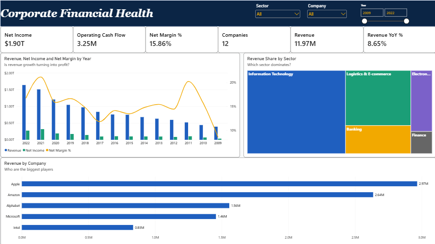
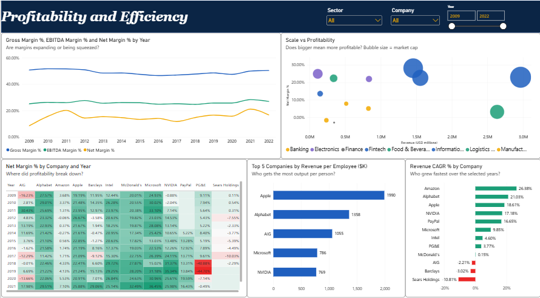
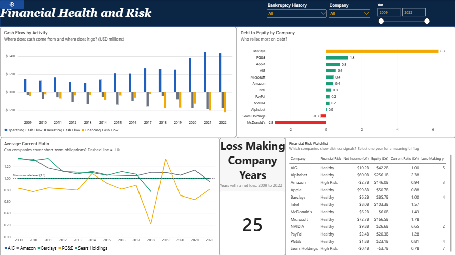

# Corporate Financial Health Dashboard | Power BI

An interactive, three-page Power BI report analyzing the financial performance, profitability, operational efficiency, and financial risk of **12 major companies across 8 sectors**, using annual financial statement data spanning 2009–2022.

**Business question:** Which companies are growing profitably, and which ones show early warning signs of financial distress?

## Dashboard Preview

### 1. Executive Overview



Provides a high-level view of revenue, net income, company performance, sector contributions, and financial trends.

### 2. Profitability & Efficiency



Evaluates profitability margins, revenue growth, return on equity, revenue per employee, and differences in performance across companies.

### 3. Financial Health & Risk



Examines liquidity, leverage, cash flows, shareholder equity, and potential financial distress signals.

## Business Questions Answered

| Report Page | Key Questions |
|---|---|
| Executive Overview | Which companies generate the most revenue? Is revenue growth translating into profits? Which sectors dominate the group? |
| Profitability & Efficiency | Which companies have the strongest margins? Are profits improving or deteriorating? Which companies generate more revenue per employee? |
| Financial Health & Risk | Can companies cover short-term obligations? How dependent are they on debt? Which businesses show potential distress signals? |

## Key Findings

- **Amazon:** Generated approximately $514 billion in revenue in 2022, but reported a net margin of approximately -0.5%, demonstrating that revenue scale does not necessarily translate into profitability.
- **Microsoft and NVIDIA:** Recorded the strongest 2022 net margins in the group, at approximately 36–37%.
- **Sears Holdings:** Reported net losses in 7 of the 10 years represented in the dataset and negative shareholder equity from 2015 onward.
- **PG&E:** Reported net losses from 2018 through 2021, including an approximately $7.7 billion loss in 2019.
- **Loss-making observations:** The dataset contains 25 company-year observations with negative net income.
- **Leverage interpretation:** Banks and insurers can have structurally high debt-to-equity ratios. McDonald's negative equity can also reflect shareholder distributions and share repurchases, so leverage is interpreted in business context rather than treated as an automatic distress indicator.

These findings reflect the selected dataset and reporting periods. Financial metrics should be interpreted in the context of each company's industry, accounting practices, and capital structure.

## Dataset

- **Source:** *Financial Statements of Major Companies (2009–2023)* by `rish59` on Kaggle, compiled from company 10-K filings.
- **File:** `data/Financial_Statements.csv`
- **Size:** 161 rows and 23 columns, covering 12 companies.
- **Units:** Monetary values are expressed in USD millions; percentage metrics are represented in percentage points where applicable.
- **Reporting period:** The dashboard focuses on complete years from 2009 through 2022. The source contains only two company records for 2023, so that year is excluded from the main analysis.

## Data Cleaning & Transformation — Power Query

Power Query was used to prepare the source data for reliable analysis.

| Data Quality Issue | Action Taken |
|---|---|
| Hidden characters and trailing spaces in headers | Cleaned and standardized column names |
| Inconsistent category labels | Standardized sector and category labels |
| Long or inconsistent column names | Renamed fields to concise, DAX-friendly names |
| Incorrect data types | Applied appropriate numeric, text, and year data types |
| Duplicate ticker-year combinations | Removed duplicate company-year records |
| Company names and sector information missing from source | Added company names and sector labels using a lookup |
| Missing PayPal market capitalization for 2014 | Preserved the value as blank rather than estimating it |
| Partial 2023 coverage | Added a complete-year/partial-year indicator in the year dimension |
| Bankruptcy history not explicitly represented | Added a manually maintained history flag for Sears Holdings and PG&E, based on public filings |

## Data Model

The report uses a star-schema-oriented model with one fact table and two dimension tables.

| Table | Description |
|---|---|
| `FactFinancials` | Financial metrics at the company-year level |
| `DimCompany` | Company ticker, company name, sector, first and last reporting years, and bankruptcy history |
| `DimYear` | Calendar year and complete/partial year classification |

### Relationships

- `DimCompany[Ticker]` connects one-to-many to `FactFinancials[Ticker]`.
- `DimYear[Year]` connects one-to-many to `FactFinancials[Year]`.

This model supports consistent filtering by company, sector, and reporting year.

## DAX Highlights

The report includes **30+ DAX measures** covering financial performance, growth, efficiency, and risk.

### Profitability
- Gross Margin %
- EBITDA Margin %
- Net Margin %
- Return on Equity (ROE) %

### Growth
- Revenue YoY %
- Net Income YoY %
- Revenue CAGR %

Growth calculations account for the available reporting periods, including company-specific first and last years for CAGR.

### Liquidity & Leverage
- Average Current Ratio
- Average Debt to Equity

### Operational Efficiency
- Revenue per Employee
- Cash Conversion

### Financial Risk Classification

Each company is classified using its latest available year within the selected reporting range.

| Risk Category | Rule | Interpretation |
|---|---|---|
| High Risk | Net loss and either negative equity or a current ratio below 1 | Multiple indicators of potential financial stress |
| Watch | Net loss without the additional high-risk conditions | Profitability concern requiring further review |
| Healthy | Does not meet either of the above rules | Does not trigger the defined screening criteria |

**Important:** These labels are screening indicators, not credit ratings, bankruptcy predictions, or definitive assessments of financial health. Industry-specific benchmarks and additional financial context are necessary for a complete evaluation.

## Tools & Technologies

- **Power BI Desktop:** Report development, visualization, and data modeling
- **Power Query (M):** Data cleaning, transformation, and validation
- **DAX:** Financial KPIs, growth calculations, profitability measures, and risk classification
- **Financial analysis:** Profitability, liquidity, leverage, growth, and efficiency
- **GitHub:** Version control and project documentation

## Repository Structure

```text
Corporate-Financial-Health-Dashboard/
├── README.md
├── data/
│   └── Financial_Statements.csv
├── powerbi/
│   └── Financial_Health_Dashboard.pbix
├── scripts/
│   ├── 01_PowerQuery_Scripts.m
│   └── 02_DAX_Measures.dax
└── images/
    ├── 01_executive_overview.png
    ├── 02_profitability.png
    └── 03_financial_health.png
```

## How to Open the Project

1. Download `powerbi/Financial_Health_Dashboard.pbix` from the repository.
2. Open the file using Power BI Desktop.
3. If prompted for the data source, update the source path to `data/Financial_Statements.csv` through **Home → Transform data → Data source settings**, or update the file path in Power Query as appropriate.
4. Refresh the data if required.
5. Navigate through the three report pages to explore company performance, profitability, and financial risk.

## Limitations & Future Improvements

- **Limited company coverage:** The analysis includes 12 companies and is not representative of the entire market.
- **Changing company coverage:** Sears Holdings exits the dataset in 2018, while PayPal appears from 2014. Combined totals across years are therefore not strictly like-for-like.
- **Industry differences:** Financial institutions and non-financial companies have different capital structures, making direct leverage comparisons potentially misleading.
- **Data availability:** Missing values and limited financial fields constrain some comparisons. Metrics such as return on assets and free cash flow depend on the definitions and fields available in the source.
- **Risk classification:** The rule-based flag is an initial screening tool and does not replace comprehensive credit or solvency analysis.

### Future Enhancements

- Expand the analysis to additional companies and reporting years using SEC filings.
- Add sector-specific financial benchmarks.
- Incorporate a broader set of liquidity and solvency indicators.
- Introduce revenue and profitability forecasting.
- Improve peer comparisons using industry-adjusted metrics.

## Project Objectives & Learning Outcomes

This project demonstrates practical experience in:

- Cleaning and validating financial statement data.
- Building a dimensional data model in Power BI.
- Developing DAX measures for profitability, growth, and efficiency.
- Comparing financial performance across companies and sectors.
- Identifying potential financial risk indicators.
- Translating financial metrics into business insights.
- Documenting an end-to-end analytics project for a professional portfolio.

## Author

**Gilbert Priscilla** · [LinkedIn](https://www.linkedin.com/in/priscilla-gilbert-9a7b5821a/) · [GitHub](https://github.com/prigil1812)

*This project is intended for educational and portfolio purposes. Findings depend on the supplied dataset and should not be interpreted as investment advice.*
